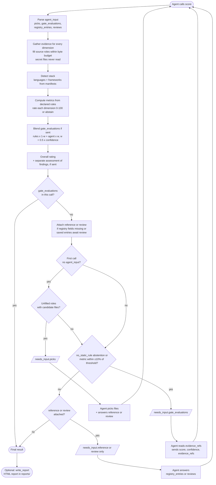

# Scoring session flow (MCP)

A scoring session is one to three `score` calls from the calling agent, then an optional
`write_report`. The engine never calls an LLM: every judgment in the flow comes from the calling
agent or the user, and every number is shown with its parts.

Source: `src/easy_verifier/adapters/mcp_server.py` (`score`) and
`src/easy_verifier/core/score.py` (`score_repository`).
The rules applied in the "Compute metrics" step are listed in
[`SCORING_RULES.md`](SCORING_RULES.md).

## Flow

## The rounds

| Call | Agent sends | Engine may ask |
|---|---|---|
| 1 | nothing (or findings) | `picks` if roles are unfilled but candidates exist; otherwise `gate_evaluations` if a dimension is gated |
| 2 | `agent_input` with picks | `gate_evaluations` only (picks are never asked twice) |
| 3 | same `agent_input` + `gate_evaluations` | nothing: this call always returns the final result |

`reference` (registry fields the detected stack lacks) and `review` (saved registry entries for the
user to approve, improve, or reject) ride along with whichever round is asked and add no round of
their own. Answers go back as `agent_input.registry_entries` and `agent_input.reviews`, and are
saved to the local registry (`/sot` in the container) so they are researched once per machine.

Findings, when passed, get a separate **assessment**. It is shown next to the rating with any
divergence and is never blended into it.

The CLI runs the same core but never asks: one pass, rules-only ratings, no `needs_input`.

## Evidence warnings

Only two things are gated (DDR-0010): solution-fit, which declares no static rule
(`no_static_rule`), and a dimension with a rule input within ±10% of its threshold. An abstention
for missing evidence (`insufficient_measured_weight` below the 50% measured-weight floor,
`below_coverage_floor`, `coverage_not_applicable`, `all_metrics_abstained`, `dimension_failed`) is
never asked about: it is listed in the payload's `warnings` and the report's "Evidence warnings"
block, and an evaluation sent for it is rejected with an error naming the dimension.

**Reading a warning.** A warned dimension has no number and is left out of the overall, so the
overall describes fewer dimensions, not a better repository. Each warning lists `unmeasured_rules`
and `sources_missing`: adding those to the repository (or widening the scope, for example
`--scope changes` for blast-radius) is the only way to get a number. Do not ask the calling agent
to supply one. See [`EVALUATION_GUIDE.md`](EVALUATION_GUIDE.md#warnings-what-could-not-be-measured).

## Large repositories: priority batches

When a scope has more source files than a code tier's cap (200), code-quality, architecture and
test-strategy no longer skip them (DDR-0010, T068). The sources are ordered by purpose class
(application/server source, other application source, scripts/tooling, generated/vendored — the
last are ordered last, never dropped; `core/batches.py:PURPOSE_CLASSES`), then by git churn (commits
touching the file in the last 400 non-merge local commits, most first; without git history: path
only, and the disclosure says so), then by path, and read in batches of 200.

- Each call reads batches 1…N afresh (stateless): the caller names only the count, never a file
  count or a metric, and the same count always gives a byte-equal payload.
- The payload's `samples` lists, per sampled dimension, `batches_done`, `batches_total`,
  `files_read`, `files_in_scope` and the `order`. Sampled metrics say
  `sample: batches N of M, X of Y files` in their derivation; code-quality's function, type-escape
  and debt-marker metrics and architecture's import cycles are computed over the whole text of
  those files, so the byte budget cutting the quoted excerpts does not make them abstain. The
  excerpts themselves stay within the budget.
- MCP: while batches remain, `needs_input.continue_batches` (`batches_done`, `batches_total`,
  `files_read`, `files_in_scope`, `question`) rides along with any round. Ask the user whether to
  read the next batch (more tokens) or stop; to continue, call `score` again with the same
  `agent_input` plus `"batches": N+1` (or `"all"`). Stopping keeps an honest result over the
  batches read.
- CLI: `score` / `write-report` take `--batches N` or `--all` (default 1); stderr says how many
  batches remain and the flag that continues.
- `batches` of 0, a non-number, or more than the scope has is a validation error, never clamped.
  At or under the cap nothing changes.

## Improvement plan

Every `score` result (CLI and MCP alike) carries `improvement_plan`, and the HTML report shows it
after the score panel. It lists every gap of every rated dimension, in three groups:

| Group | Meaning |
|---|---|
| P0 | near miss: the rule is unmet but its value is within ±10% (`BORDERLINE_BAND`) of the threshold; a threshold of 0 is never a near miss |
| P1 | clear failure: the rule is unmet and outside the band |
| P2 | not measurable yet: the rule's metric abstained |

Each item gives the metric, its value, the rule, the cited files, a static engine fix line
(`fix.source = "engine"`), and what fixing it is worth: `dimension_gain` and `overall_gain`. The
gain is **recomputed** with the rating arithmetic as if that one rule passed (rounded once, ties to
even), never read off the weight. A P2 gain is a range `[if it fails, if it passes]`, and the low
end may be negative. A gated dimension's items use its rules part (`gain_basis: "rules"`); the
agent half of a blend is never predicted. Inside a group items are ordered by overall gain (P2 by
the high end), then dimension, then metric name. A dimension without a rules rating gets one
`abstained` line with its reason code instead of items; when it has unmeasured rules (for example
`insufficient_measured_weight`) the line lists them as `unmeasured` with reason and fix text. When every group is empty the report says
"No gaps".

**Acting on the plan.** Open an item's cited files and confirm the finding before changing code: a
rule counts scanner matches, and a false match (for example a filename read as a secret) is still
counted. Then fix P0 before P1, each by `overall_gain`. Gains are per item and do not add up;
score again after each change. A P2 item needs evidence before it is measurable, and measuring it
can lower the number (the low end of its range). See
[`EVALUATION_GUIDE.md`](EVALUATION_GUIDE.md#improvement-plan).
